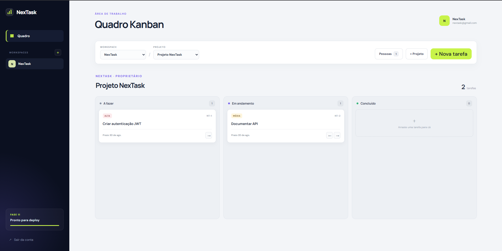
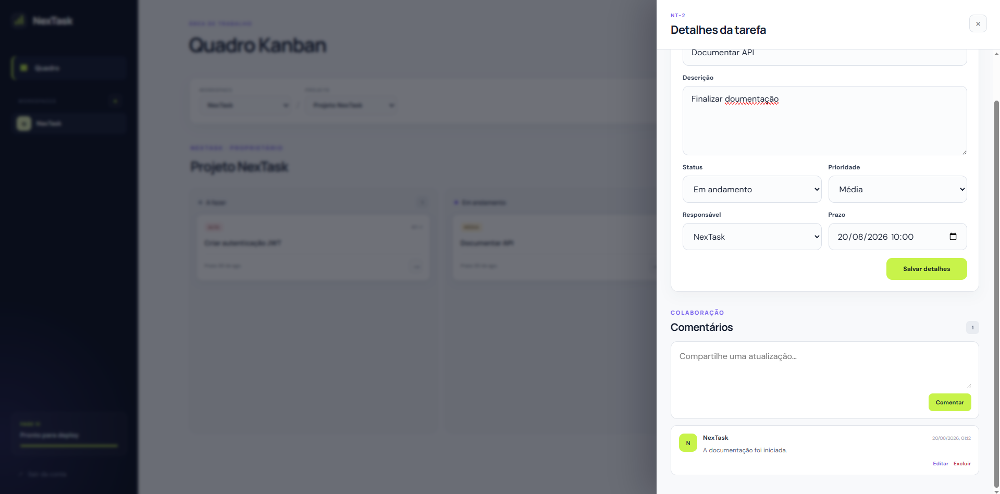
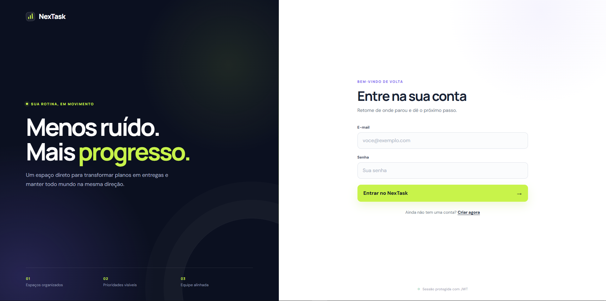
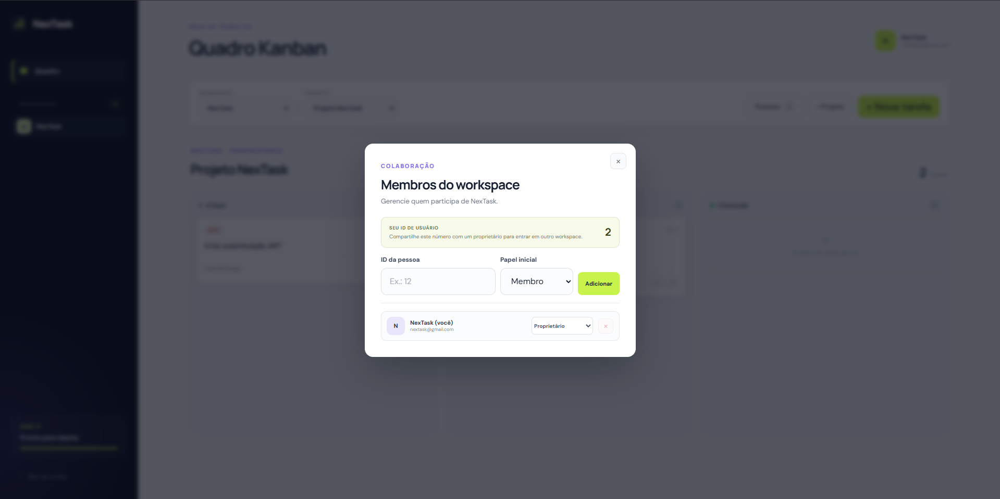

# NexTask

Full Stack project management platform with Kanban boards, workspaces, teams and task collaboration.

## Status

Em desenvolvimento — Fase 11 concluída: imagens de produção, execução integrada com Docker Compose e integração contínua no GitHub.

## Objetivo

O NexTask será uma aplicação web para gerenciamento colaborativo de projetos e tarefas. O projeto é construído de forma incremental como portfólio profissional, priorizando aprendizado, segurança, testes e decisões arquiteturais justificadas.

## Demonstração

### Quadro Kanban

Organização visual de tarefas por status, com prioridades, prazos e movimentação entre colunas.

[](docs/images/nextask-kanban.png)

### Detalhes e colaboração

Edição completa da tarefa, responsável, prazo e comentários com autoria e moderação.

[](docs/images/nextask-task-details.png)

| Autenticação protegida por JWT | Gestão de membros e papéis |
| --- | --- |
| [](docs/images/nextask-login.png) | [](docs/images/nextask-members.png) |

## Arquitetura inicial

```text
       Navegador
           ↓
    NGINX + React
           ↓ /api
   Spring Boot 3 REST
           ↓
    Spring Data JPA
           ↓
 Microsoft SQL Server
```

O backend começa como um monólito modular em camadas. Os packages de cada módulo serão criados apenas quando a respectiva funcionalidade for implementada; Git não versiona diretórios vazios.

## Tecnologias da base atual

- Java 21 LTS
- Spring Boot 3.5
- Maven
- Spring Web
- Spring Data JPA / Hibernate
- Bean Validation
- Spring Security / PBKDF2
- OAuth2 Resource Server / JWT
- Springdoc OpenAPI / Swagger UI
- Spring Boot Actuator
- Microsoft SQL Server 2022 Express
- JUnit 5
- React 19 + TypeScript 6
- Vite 8
- React Router 7
- Vitest + Testing Library
- pnpm 11
- Docker + Docker Compose
- NGINX sem privilégios de administrador
- GitHub Actions + Dependabot

O backend possui autenticação stateless com tokens JWT assinados por HMAC e documentação OpenAPI navegável. O frontend mantém a sessão somente na aba atual, oferece um quadro Kanban com movimentação acessível e integra detalhes de tarefas, responsáveis, comentários e gestão de membros.

## Pré-requisitos

- Java 21
- Maven 3.6.3 ou superior, ou Maven Wrapper incluído no projeto
- Node.js 22.13 ou superior
- pnpm 11
- Git
- SQL Server Express com a instância `SQLEXPRESS`
- SQL Server Management Studio (SSMS) ou o utilitário `sqlcmd`
- IDE com suporte a Java (IntelliJ IDEA, Eclipse/STS ou VS Code)
- Docker Desktop, opcional para executar toda a aplicação em contêineres

## Executar localmente

1. Crie o arquivo local de segredos:

   ```powershell
   Copy-Item .env.example .env
   ```

2. Troque a senha de exemplo em `.env` e gere uma chave JWT privada. O arquivo é ignorado pelo Git.

   ```powershell
   $jwtBytes = New-Object byte[] 32
   $jwtGenerator = [Security.Cryptography.RandomNumberGenerator]::Create()
   try {
       $jwtGenerator.GetBytes($jwtBytes)
   } finally {
       $jwtGenerator.Dispose()
   }
   $jwtSecret = [Convert]::ToBase64String($jwtBytes)
   (Get-Content .env) -replace '^JWT_SECRET=.*$', "JWT_SECRET=$jwtSecret" | Set-Content .env
   Remove-Variable jwtSecret, jwtBytes, jwtGenerator
   ```

3. Confirme no SQL Server que o modo de autenticação selecionado é **SQL Server e Windows**. Se precisar alterá-lo no SSMS, reinicie o serviço `SQL Server (SQLEXPRESS)`.

4. Prepare o banco usando sua autenticação do Windows:

   ```powershell
   powershell.exe -NoProfile -ExecutionPolicy Bypass -File .\database\setup-database.ps1
   ```

   O script cria de forma idempotente o banco `nextask`, o login `nextask_app`, suas permissões mínimas de leitura e escrita e o schema da fase atual.
   Aguarde a mensagem `NexTask database, schema, and application login are ready.` antes de iniciar o backend ou os testes de integração. O `Bypass` vale apenas para esse processo e não altera permanentemente a política do PowerShell.

5. Execute o backend:

   ```powershell
   Get-Content .env |
       Where-Object { $_ -match '^[^#][^=]*=' } |
       ForEach-Object {
           $entry = $_ -split '=', 2
           [Environment]::SetEnvironmentVariable($entry[0].Trim(), $entry[1], 'Process')
       }
   Set-Location backend
   .\mvnw.cmd spring-boot:run
   ```

   As variáveis são carregadas apenas nesse PowerShell e seus valores não são exibidos na tela.

6. Em outro terminal, consulte a saúde da aplicação:

   ```powershell
   Invoke-RestMethod http://localhost:8080/actuator/health
   ```

   Resultado esperado:

   ```json
   {"status":"UP"}
   ```

7. Em outro terminal, instale e inicie o frontend:

   ```powershell
   Set-Location frontend
   pnpm install
   pnpm dev
   ```

8. Abra o NexTask no navegador:

   ```text
   http://localhost:5173
   ```

   O Vite encaminha chamadas `/api` para `http://localhost:8080`, portanto o backend deve continuar ligado. Use a tela para criar uma conta ou entrar; após a autenticação, a rota `/app` permite criar o primeiro workspace, projeto e tarefas do quadro Kanban.

9. Abra a documentação interativa do backend quando precisar inspecionar os contratos:

   ```text
   http://localhost:8080/swagger-ui.html
   ```

   Use `POST /api/auth/register` ou `POST /api/auth/login`, copie apenas o valor de `accessToken` e informe-o no botão **Authorize**. A interface adiciona o prefixo `Bearer` automaticamente.

## Executar com Docker

Esta opção inicia frontend, backend e um SQL Server isolado com um único comando. Ela não usa nem altera a instância `SQLEXPRESS` instalada no Windows.

1. Com o Docker Desktop aberto, gere os segredos locais:

   ```powershell
   powershell.exe -NoProfile -ExecutionPolicy Bypass -File .\scripts\setup-compose-env.ps1
   ```

   O script cria `.env.compose` com valores aleatórios, não mostra as senhas na tela e se recusa a substituir um arquivo existente.

2. Construa e inicie a aplicação:

   ```powershell
   docker compose --env-file .env.compose up --build
   ```

3. Aguarde os serviços ficarem saudáveis e abra:

   ```text
   http://localhost:8080
   ```

4. Para encerrar, pressione `Ctrl+C` e execute:

   ```powershell
   docker compose --env-file .env.compose down
   ```

O banco fica preservado no volume `nextask_sqlserver-data`. O Swagger permanece desabilitado no perfil de produção; para habilitá-lo temporariamente, altere `OPENAPI_ENABLED` para `true` em `.env.compose` e reinicie os serviços.

## Testes

Teste rápido, sem depender do banco:

```powershell
Set-Location backend
.\mvnw.cmd test
```

Teste real de integração com SQL Server:

```powershell
.\mvnw.cmd verify -Pintegration-test
```

Os testes confirmam 37 cenários rápidos e 16 cenários de integração, cobrindo autenticação, emissão e validação de tokens, identidade autenticada, documentação OpenAPI, regras `OWNER`/`MEMBER` e os fluxos HTTP completos no SQL Server.

Qualidade e build do frontend:

```powershell
Set-Location frontend
pnpm lint
pnpm test
pnpm build
```

O frontend possui 14 testes automatizados para rotas protegidas, autenticação, sessão, onboarding, Kanban, detalhes e responsáveis, comentários, membros, erros da API e expiração da autenticação. O build também executa a verificação estrita de tipos do TypeScript.

## Integração contínua

O workflow em `.github/workflows/ci.yml` é executado automaticamente em cada envio para `main` e em pull requests. Ele testa o backend, analisa, testa e compila o frontend, valida o Docker Compose e constrói as duas imagens de produção. O Dependabot verifica semanalmente atualizações das ações e imagens Docker.

## Segurança local

- `.env` nunca deve ser enviado ao GitHub.
- `.env.compose` também é privado e nunca deve ser enviado ao GitHub.
- `JWT_SECRET` deve conter pelo menos 32 bytes aleatórios codificados em Base64 e nunca deve ser publicado.
- Tokens inválidos ou ausentes recebem `401`; operações sem permissão no workspace recebem `403`.
- A documentação fica ativa por padrão no ambiente local e pode ser desabilitada com `OPENAPI_ENABLED=false`.
- O frontend mantém o JWT em `sessionStorage`: a sessão sobrevive a uma atualização da página, mas é removida ao fechar a aba ou sair da conta.
- Variáveis prefixadas com `VITE_` ficam disponíveis no navegador e nunca devem conter segredos.
- A aplicação não usa sua conta do Windows nem a conta administrativa `sa`.
- `trustServerCertificate=true` é aceito somente no ambiente local; em produção será usado um certificado confiável.
- O Hibernate está configurado com `ddl-auto=validate`, portanto não altera o schema silenciosamente.

## Documentação

Os roteiros explicados estão disponíveis por fase:

- [`docs/phase-1.md`](docs/phase-1.md): preparação, configuração do Git e publicação;
- [`docs/phase-2.md`](docs/phase-2.md): modelagem da tabela `users` e da entidade `User`;
- [`docs/phase-3.md`](docs/phase-3.md): API REST, validação, erros e hash de senha;
- [`docs/phase-4.md`](docs/phase-4.md): workspaces, membros, papéis e consistência transacional;
- [`docs/phase-5.md`](docs/phase-5.md): projetos, tarefas, comentários e concorrência otimista.
- [`docs/phase-6.md`](docs/phase-6.md): Spring Security, JWT, identidade autenticada e autorização.
- [`docs/phase-7.md`](docs/phase-7.md): contrato OpenAPI, Swagger UI e testes da documentação.
- [`docs/phase-8.md`](docs/phase-8.md): React, autenticação, sessão no navegador, rotas e testes do frontend.
- [`docs/phase-9.md`](docs/phase-9.md): workspaces, projetos, tarefas e primeiro quadro Kanban.
- [`docs/phase-10.md`](docs/phase-10.md): detalhes de tarefas, responsáveis, comentários e membros.
- [`docs/phase-11.md`](docs/phase-11.md): imagens de produção, Docker Compose e integração contínua.

## Roadmap resumido

- [x] Estrutura inicial do repositório
- [x] Backend Spring Boot
- [x] Script reproduzível de configuração do SQL Server
- [x] Validar banco e aplicação no ambiente local
- [x] Modelagem persistente de usuários
- [x] API de usuários
- [x] Workspaces e permissões
- [x] Projetos, tarefas e comentários
- [x] Spring Security e JWT
- [x] Swagger/OpenAPI
- [x] React, autenticação e navegação protegida
- [x] Workspaces e primeiro quadro Kanban
- [x] Detalhes de tarefas, comentários e membros no frontend
- [x] Preparação reproduzível para deploy e integração contínua
- [ ] Publicação em uma plataforma de hospedagem
